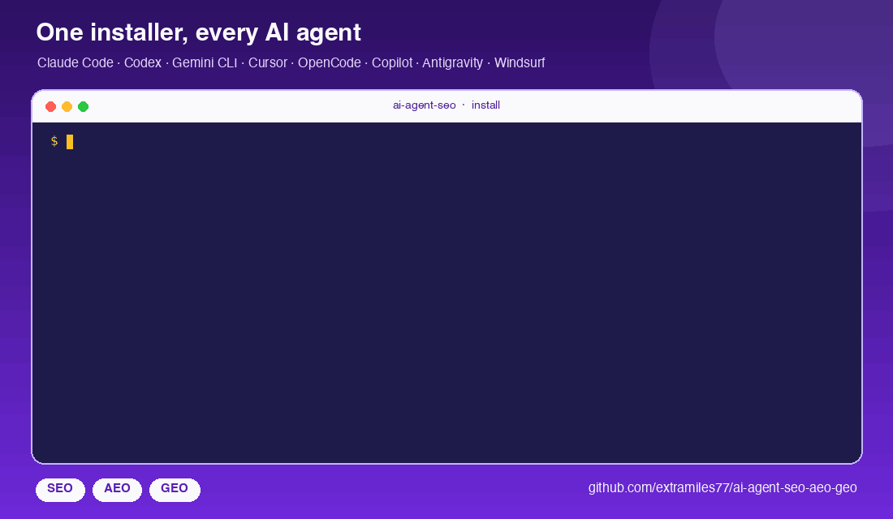
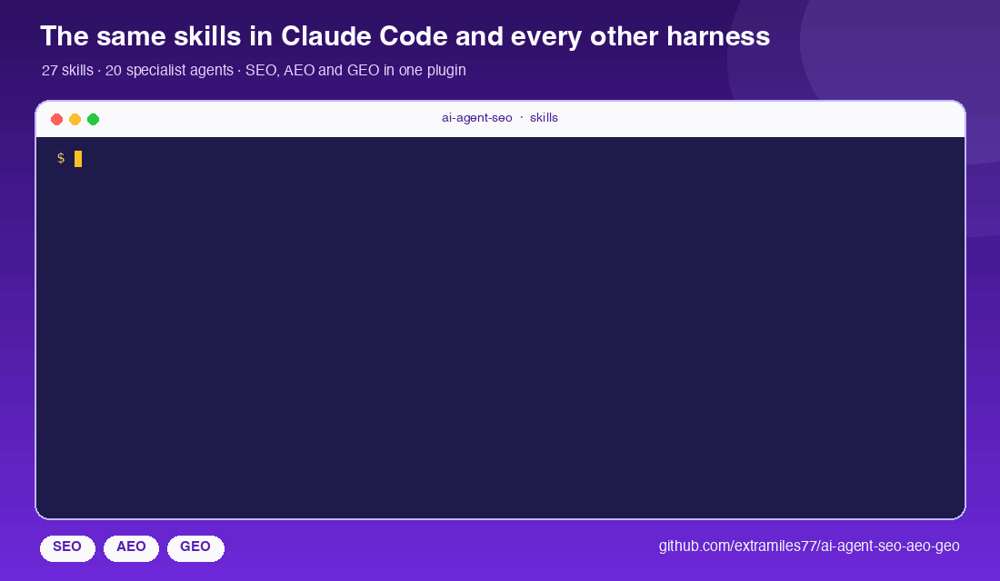
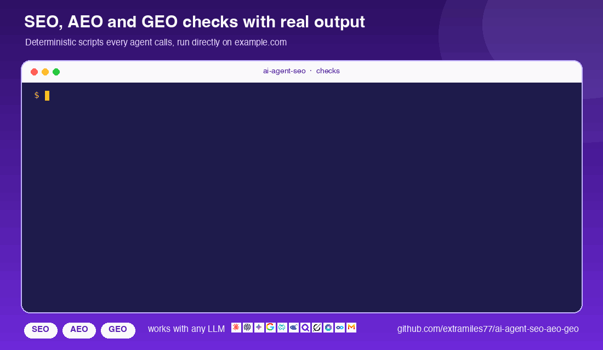

<!--
  AI Agent SEO: free, open-source SEO audit skills for Claude Code and any AI agent (Codex, Gemini, Cursor, OpenCode, Copilot, Antigravity, Windsurf).
  Technical SEO, Core Web Vitals, E-E-A-T, Schema.org, AI search (GEO), local SEO, e-commerce and international SEO.
  SEO, AEO (answer engines) and GEO (AI search). 27 sub-skills and 20 specialist agents. MIT licensed.
-->



<h1 align="center">AI Agent SEO</h1>

<p align="center">
  <b>Free, open-source SEO audits inside <a href="https://claude.com/product/claude-code">Claude Code</a> and any AI agent that reads Agent Skills.</b><br />
  Rank higher in Google and get cited by AI search.
</p>

<p align="center">
  <a href="#install">Install</a> ·
  <a href="#see-it-in-action">Demo</a> ·
  <a href="#meet-the-team">Team</a> ·
  <a href="#commands">Commands</a> ·
  <a href="#pricing">Pricing</a> ·
  <a href="#faq">FAQ</a>
</p>

**AI Agent SEO is a free SEO plugin for Claude Code that also runs in Codex, Gemini CLI, Cursor, OpenCode, GitHub Copilot, Antigravity and Windsurf, with any model.** Give it any website and it runs a full SEO audit in 10 to 15 minutes, then hands you a clear action plan, sorted by what matters most.

It checks everything a good SEO consultant would:

- **Technical SEO.** Crawlability, indexing, sitemaps, robots.txt, redirects, page speed and Core Web Vitals.
- **Content quality.** E-E-A-T (experience, expertise, authority and trust), thin pages and topic coverage.
- **Structured data.** Finds, validates and writes Schema.org markup for rich results.
- **AI search (GEO).** How likely Google AI Overviews, AI Mode, ChatGPT, Perplexity and Gemini are to cite your pages.
- **Local and e-commerce SEO.** Google Business Profile, reviews, map pack, product pages and international sites.

AI Agent SEO is built from 27 sub-skills and 20 specialist agents, and up to 18 agents work on your site at the same time. Every recommendation explains why it matters and how you will know it worked.

## See it in action

The demos below are rendered from real command output (how: [docs/demos](docs/demos/README.md)).

Install once for every AI agent on your machine:



The same 27 skills and 20 agents, in Claude Code and in the shared `~/.agents/skills` folder:



SEO, AEO and GEO checks: the optimization focus, the answer-engine score and the agent-readiness checks on example.com:



## Meet the team



<details>
<summary><b>All 20 agents</b></summary>
<br />

| Agent | Role | Model | Command |
|---|---|---|---|
| `seo-technical` | Technical SEO Lead | Sonnet | `/seo technical` |
| `seo-content` | Content Editor | Opus | `/seo content` |
| `seo-schema` | Structured Data Engineer | Sonnet | `/seo schema` |
| `seo-sitemap` | Sitemap Architect | Sonnet | `/seo sitemap` |
| `seo-performance` | Performance Engineer | Sonnet | `/seo audit` |
| `seo-visual` | Visual QA | Sonnet | `/seo audit` |
| `seo-geo` | AI Search Analyst | Opus | `/seo geo` |
| `seo-aeo` | Answer Engine Analyst | Sonnet | `/seo aeo` |
| `seo-agentic` | Agent Readiness Analyst | Sonnet | `/seo agentic` |
| `seo-local` | Local SEO Specialist | Sonnet | `/seo local` |
| `seo-maps` | Maps Analyst | Sonnet | `/seo maps` |
| `seo-google` | Google Data Analyst | Sonnet | `/seo google` |
| `seo-backlinks` | Link Analyst | Sonnet | `/seo backlinks` |
| Live data (extension) | Live Data Analyst | Sonnet | `/seo audit` |
| `seo-image-gen` | Image Producer (extension) | Sonnet | `/seo image-gen` |
| `seo-cluster` | Topic Strategist | Opus | `/seo cluster` |
| `seo-sxo` | Search Experience Designer | Opus | `/seo sxo` |
| `seo-drift` | Change Monitor | Opus | `/seo drift` |
| `seo-ecommerce` | E-commerce Specialist | Sonnet | `/seo ecommerce` |
| `seo-flow` | FLOW Strategist | Sonnet | `/seo flow` |

</details>

**Built for:**

- **SEO agencies** that want weekly audits for every client instead of quarterly ones, with change monitoring to catch problems in between.
- **In-house SEO teams** at SaaS, publishing and e-commerce companies that want a second pair of eyes before every review, AI search included.
- **Freelance SEO consultants** who want to run an audit on the first call and show a real score and the top fixes before writing a proposal.

## Commands



32 core and extension commands in six groups. Open one to see what is inside; a few more extension commands are in the [full command reference](docs/COMMANDS.md).

<details>
<summary><b>Audits and Planning</b> (6 commands)</summary>
<ul><li><code>/seo settings [set focus balanced|seo|aeo|geo]</code>: Choose what audits weigh most: SEO, AEO or GEO</li><li><code>/seo setup</code>: Create or refresh the isolated Python runtime and Chromium</li><li><code>/seo doctor</code>: Check runtime readiness without changing the system</li><li><code>/seo audit &lt;url&gt;</code>: Full website audit with parallel agents</li><li><code>/seo page &lt;url&gt;</code>: Deep single-page analysis</li><li><code>/seo plan &lt;type&gt;</code>: Strategic SEO planning (saas, local, ecommerce, publisher, agency)</li></ul>
</details>
<details>
<summary><b>Technical SEO</b> (7 commands)</summary>
<ul><li><code>/seo technical &lt;url&gt;</code>: Technical SEO audit across 9 categories</li><li><code>/seo sitemap &lt;url | generate&gt;</code>: Analyze or generate XML sitemaps</li><li><code>/seo images &lt;url&gt;</code>: Image optimization analysis</li><li><code>/seo hreflang &lt;url&gt;</code>: Hreflang and i18n SEO audit and generation</li><li><code>/seo programmatic &lt;url&gt;</code>: Programmatic SEO analysis and planning</li><li><code>/seo google [command]</code>: Google SEO APIs: GSC, PageSpeed, CrUX, Indexing, GA4, PDF reports</li><li><code>/seo drift baseline | compare | history &lt;url&gt;</code>: SEO drift monitoring with SQLite snapshots</li></ul>
</details>
<details>
<summary><b>Content and E-E-A-T</b> (6 commands)</summary>
<ul><li><code>/seo content &lt;url&gt;</code>: E-E-A-T and content quality analysis</li><li><code>/seo content-brief &lt;topic&gt;</code>: Content brief: target keywords, outline, internal links</li><li><code>/seo cluster &lt;keyword&gt;</code>: SERP-based semantic clustering</li><li><code>/seo sxo &lt;url&gt;</code>: Search Experience Optimization: page type, user stories, personas</li><li><code>/seo flow [stage]</code>: FLOW framework prompts (CC BY 4.0, evidence-led)</li><li><code>/seo competitor-pages &lt;url&gt;</code>: Competitor comparison page generation</li></ul>
</details>
<details>
<summary><b>Schema, AEO and AI Search</b> (4 commands)</summary>
<ul><li><code>/seo schema &lt;url&gt;</code>: Detect, validate and generate Schema.org markup</li><li><code>/seo aeo &lt;url&gt;</code>: Answer Engine Optimization: featured snippets, People Also Ask, voice, answer-first rewrites</li><li><code>/seo geo &lt;url&gt;</code>: AI Overviews and Generative Engine Optimization</li><li><code>/seo agentic &lt;url&gt;</code>: Agent readiness: Lighthouse Agentic Browsing X/N, AI agent access, llms.txt, Markdown, WebMCP</li></ul>
</details>
<details>
<summary><b>Local, Links, Commerce</b> (4 commands)</summary>
<ul><li><code>/seo local &lt;url&gt;</code>: Local SEO: GBP, citations, reviews, map pack</li><li><code>/seo maps [command]</code>: Maps intelligence: geo-grid, GBP audit, reviews, competitors</li><li><code>/seo backlinks &lt;url&gt;</code>: Backlink profile analysis (Moz, Bing, Common Crawl)</li><li><code>/seo ecommerce &lt;url&gt;</code>: E-commerce SEO and marketplace intelligence</li></ul>
</details>
<details>
<summary><b>Extensions</b> (5 commands)</summary>
<ul><li><code>/seo image-gen [use-case]</code>: AI image generation for SEO assets</li><li><code>/seo seranking [command]</code>: AI Share-of-Voice across ChatGPT, Gemini, Perplexity, AI Overviews, AI Mode</li><li><code>/seo profound [command]</code>: LLM citation tracking with time-series data</li><li><code>/seo bing [command] &lt;url&gt;</code>: Bing Webmaster Tools + IndexNow URL submission</li><li><code>/seo unlighthouse &lt;url&gt;</code>: Multi-page Lighthouse runner, runs locally</li></ul>
</details>

## Pricing



<details>
<summary><b>The full comparison</b></summary>
<br />

| | Doing it by hand | Hiring an agency | SEO audit software | **AI Agent SEO** |
|---|---|---|---|---|
| **Time per audit** | 4 to 8 hours | 1 to 3 weeks | 10 to 45 minutes | **10 to 15 minutes** |
| **Cost** | Billable hours | $2k to $15k+ per project | $99 to $999 a month | **Free, with your Claude Code plan** |
| **Consistent checks** | Depends on who does it | Depends on the team | Yes | **Same checklist every time** |
| **What you get** | A spreadsheet or PDF | A slide deck | A dashboard and CSV exports | **Markdown, PDF and JSON files you keep** |
| **Your data stays with you** | Yes | No | No | **Yes, it runs on your machine** |
| **Covers AI search** | Depends | Depends | Often months behind | **Yes, follows Google's latest guidance** |
| **Each fix comes with a way to check it worked** | Sometimes | Sometimes | Rarely | **Yes** |

> Typical market prices, for illustration. Your numbers may differ.

</details>

## How an audit works

1. **It learns your site.** AI Agent SEO detects the type of business (SaaS, local, e-commerce, publisher or agency) and adjusts its checks.
2. **The team fans out.** Up to 17 specialist agents audit the site in parallel: technical, content, schema, speed, AI search and more.
3. **You get a plan, not a pile of warnings.** Findings are scored and sorted into a prioritized action plan. Each recommendation says what it is based on, what it depends on and how you will know it worked.

Reports are saved as Markdown, and `/seo google report` turns them into a polished PDF.

<details>
<summary><b>See a real report</b>: the start of a schema audit</summary>

```markdown
# Schema Markup Report: rankenstein.pro/about

| Metric              | Value                                       |
|---------------------|---------------------------------------------|
| JSON-LD Blocks      | 3                                           |
| Schema Types        | Organization, WebSite, SoftwareApplication  |
| Critical Issues     | 2                                           |
| Warnings            | 5                                           |
| Passed Checks       | 18                                          |
| Overall Grade       | B+ (solid foundation, actionable gaps)      |

**Critical Issue:** The `founder` property only includes extramiles77.
Benjamin Samar (Co-Founder and Technical Director) is displayed on the page
but absent from the schema. This content-schema mismatch can confuse search engines.
```

</details>

Want the details? Read the [methodology](skills/seo/references/thinking-framework.md) and the [architecture](docs/ARCHITECTURE.md).

## Install

You need Python 3.11 to 3.14 and one AI agent: [Claude Code](https://claude.com/product/claude-code) 1.0.33 or newer, or any harness listed under "Use it with any AI agent" below.

**Claude Code as a plugin** (recommended for Claude; enables the schema-validation hook). Inside Claude Code:

```bash
/plugin marketplace add extramiles77/ai-agent-seo-aeo-geo   # or the path to a local checkout
/plugin install ai-agent-seo@ai-agent-seo-marketplace
/seo setup
```

**Claude Code manual install.** Clone https://github.com/extramiles77/ai-agent-seo-aeo-geo (or use a local copy), then from the checkout run the installer for your platform:

```bash
bash install.sh
```

```powershell
powershell -ExecutionPolicy Bypass -File install.ps1
```

The installer copies the 27 skills and 20 agents into `~/.claude/skills` and `~/.claude/agents`, then provisions the isolated Python runtime. It reads only from this directory; nothing is downloaded from a repository.

Then, inside Claude Code:

```bash
/seo doctor        # read-only readiness check
/seo setup         # only if doctor reports the runtime is missing
```

`/seo setup` prepares everything AI Agent SEO needs (its own Python environment and a headless browser) without touching the rest of your system.

**Your first audit:**

```bash
claude                                   # start Claude Code

/seo audit https://example.com           # full site audit with a prioritized plan
/seo page https://example.com/pricing    # one page, in depth
/seo geo https://example.com             # how ready you are for AI search
/seo schema https://example.com          # check and generate structured data
/seo local https://example.com           # local SEO and Google Business Profile
```

### Use it with any AI agent (Codex, Gemini, Cursor, OpenCode, Copilot, Antigravity, Windsurf)

The skills follow the open Agent Skills format, so they run in every harness
that reads `SKILL.md` folders, with any model provider behind it (OpenAI,
Google, Anthropic, DeepSeek, Mistral, local models through OpenCode, ...).
Pass `--target` to the same installer:

```bash
bash install.sh --list                 # which harnesses are on this machine
bash install.sh --target agents        # ~/.agents/skills: Codex CLI, Gemini CLI, Cursor, OpenCode, GitHub Copilot
bash install.sh --target antigravity   # ~/.gemini/config/skills
bash install.sh --target windsurf      # ~/.codeium/windsurf/skills
bash install.sh --target all           # every detected harness, one shared runtime
bash install.sh --project . --target agents      # this project only (.agents/skills)
bash install.sh --dest /path/to/skills           # any other harness
```

```powershell
.\install.ps1 -Target agents
```

| Harness | How to run a command |
|---|---|
| Claude Code | `/seo audit https://example.com` |
| OpenAI Codex CLI | `$seo audit https://example.com` (enable network access for the sandbox) |
| Cursor | `/seo audit https://example.com` |
| Gemini CLI, GitHub Copilot, Antigravity, OpenCode, Windsurf | "Use the seo skill to audit https://example.com" (the skill also loads automatically) |

Harnesses without a subagent tool run the specialist agents one after another
from `seo/subagents/`, so a full audit takes longer but covers the same checks.
Remove an install with `./scripts/ai-agent-seo uninstall --target agents`.

## FAQ

<details>
<summary><b>What is AI Agent SEO?</b></summary>
<br />

A free, open-source SEO audit tool that runs inside Claude Code. It checks technical SEO, Core Web Vitals, content quality, Schema.org structured data, AI search readiness, local SEO, e-commerce and international SEO, then gives you a prioritized action plan. It follows Google's own documentation, including the [AI Optimization Guide](https://developers.google.com/search/docs/fundamentals/ai-optimization-guide).

</details>

<details>
<summary><b>Is it really free?</b></summary>
<br />

Yes. It is MIT licensed, with no per-site pricing, no usage limits and no tracking. You only need Claude Code. A few optional extensions connect to paid services where you bring your own account, but everything works without them.

</details>

<details>
<summary><b>Do I need API keys?</b></summary>
<br />

No. AI Agent SEO works out of the box. If you want real field data, you can connect free Google APIs (PageSpeed Insights, Chrome UX Report, Search Console and Google Analytics 4) with `/seo google setup`. Your keys stay on your machine.

</details>

<details>
<summary><b>How does it help with AI search like Google AI Overviews and ChatGPT?</b></summary>
<br />

Google says optimizing for AI search is still SEO, so AI Agent SEO starts with the basics that AI answers rely on: being indexed, fast and clear. Then `/seo geo` scores how easy your pages are to quote, checks that AI crawlers can reach them and looks at your brand's presence on Wikipedia, Reddit, YouTube and LinkedIn. `/seo agentic` checks how well AI agents can use your site.

</details>

<details>
<summary><b>Does it work on JavaScript sites like Next.js, React or Vue?</b></summary>
<br />

Yes. When a page needs JavaScript to show its content, AI Agent SEO opens it in a headless browser automatically, so single-page apps are audited as visitors see them.

</details>

<details>
<summary><b>How is it different from Screaming Frog or other SEO tools?</b></summary>
<br />

Crawlers like Screaming Frog crawl faster and deeper, and big SEO suites have their own backlink databases. AI Agent SEO does something else: it explains what it finds, sorts it by impact, covers AI search in depth and lets you ask follow-up questions in plain English. Many people use both.

</details>

<details>
<summary><b>Does my data leave my computer?</b></summary>
<br />

AI Agent SEO runs inside Claude Code, so the pages and data it analyzes are sent to Claude, Anthropic's model, the same as anything else you work on in Claude Code. Reports are saved as files on your machine. No SEO service or other third party sees your data unless you connect an extension or API yourself. Besides the site you audit, some checks read public sources such as Wikipedia, Reddit and Common Crawl. See [PRIVACY.md](PRIVACY.md) for the full list.

</details>

<details>
<summary><b>Good to know: requirements, limits and uninstall</b></summary>
<br />

**Requirements.** Claude Code 1.0.33 or newer and Python 3.11 to 3.14. `/seo setup` installs the headless browser for you.

**Cost of a full audit.** Five agents that need more judgment run on Opus and the rest on Sonnet, so a full `/seo audit` uses more of your Claude plan than a single-page check. You can change any agent's model in its file under [`agents/`](agents/).

**Limits.** Without Google API keys, Core Web Vitals are lab estimates and indexing is inferred from the page. Pages that load key content only after scrolling or clicking can give noisy results.

**Uninstall.** From the same checkout:

```bash
bash uninstall.sh
```

```powershell
powershell -ExecutionPolicy Bypass -File uninstall.ps1
```

If you installed the plugin through a marketplace instead, remove it with `/plugin uninstall` followed by the plugin name.

</details>

## Extensions

Optional add-ons that bring in more data. AI Agent SEO works fully without them.

- **Banana:** AI images for SEO, from social previews to blog heroes (Claude Banana)
- **SE Ranking:** your share of voice in ChatGPT, Gemini, Perplexity and Google AI answers
- **Profound:** tracks when AI models cite your site
- **Bing Webmaster:** Bing data plus instant IndexNow submission
- **Unlighthouse:** Lighthouse scores for every page of your site

Setup guides live in [`extensions/`](extensions/).

**Docs:** [Installation](docs/INSTALLATION.md) · [Commands](docs/COMMANDS.md) · [Architecture](docs/ARCHITECTURE.md) · [Troubleshooting](docs/TROUBLESHOOTING.md) · [Extensions setup](docs/MCP-INTEGRATION.md) · [Security](SECURITY.md) · [Privacy](PRIVACY.md)

## License and contributing

MIT License, see [LICENSE](LICENSE). Contributions are welcome: read [CONTRIBUTING.md](CONTRIBUTING.md) first and mention the checks you ran in your pull request.

## Author

Built by **extramiles77**.

MIT License, see [LICENSE](LICENSE).
